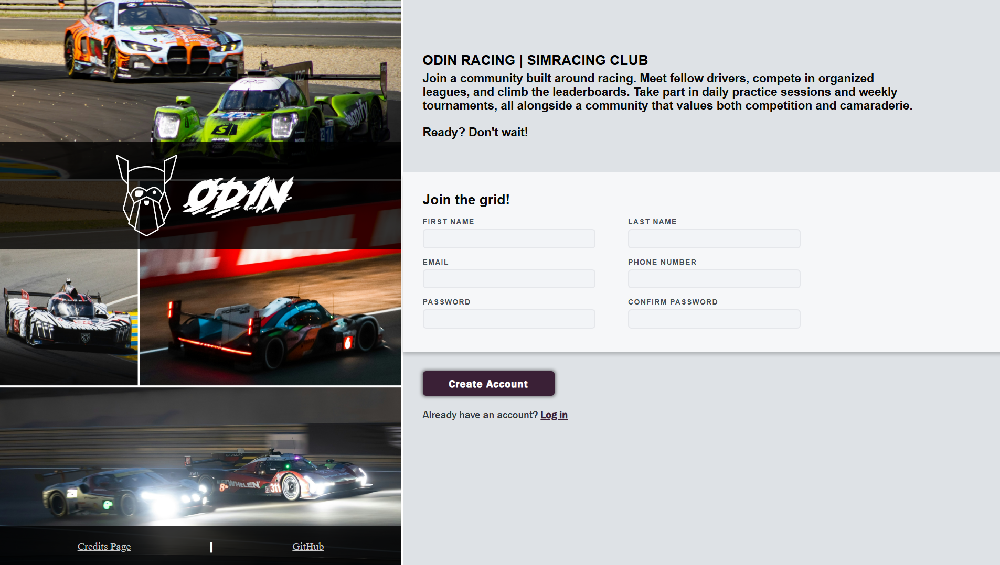

# Sign-up Form

This is Sign-up form page built with HTML, CSS and JavaScript as part of The Odin Project Foundations course.

## About this project

This registration form was created for a fictional sim-racing club, which is why the page features a racing theme.

## Features

- Interacting with input fields and links
- Checking password length and matching
- Input field validation status based on entered values
- A dedicated, full-fledged page with photo credits

## Technologies

- HTML5
- CSS3
- JavaScript

## Live Demo & Screenshot

[Live Demo](https://rayzenxf.github.io/sign-up-form/)

## What I learned

- Basic website structure ✅
- CSS pseudo-classes and selectors ✅
- Details about inputs ✅
- Adding fonts ✅
- Custom form validation using setCustomValidity() ✅

## Acknowledgements

Project idea from The Odin Project Foundations course 🙏

This project marks the completion of the Foundations course in [The Odin Project](https://www.theodinproject.com/).
It was a fun challenge that helped me combine HTML, CSS, JavaScript and Git into one complete application!